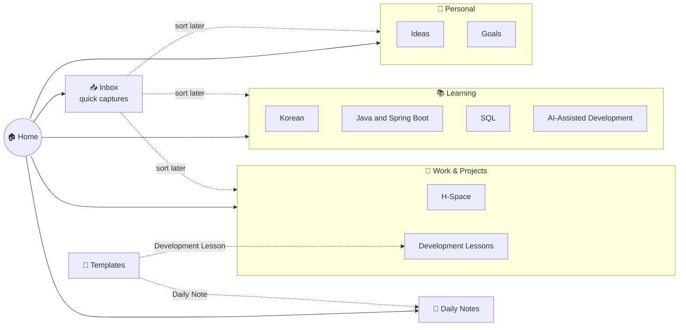

# My Second Brain

## Diagram

## Vault map
- **Inbox/**: quick captures. Sort them into a folder later.
- **Work & Projects/**: project notes and development lessons
- **Learning/**: Java, Spring Boot, SQL, AI-assisted development, Korean
- **Daily Notes/**: one note per days 
- **Templates/**: [[Templates/Daily Note|Daily Note]], [[Templates/Development Lesson|Development Lesson]]

## Work
- [[H-Space]]
- [[Development Lessons]]

## Learning
- [[Korean]]
- [[Java and Spring Boot]]
- [[SQL]]
- [[AI-Assisted Development]]

## Personal
- [[Ideas]]
- [[Goals]]